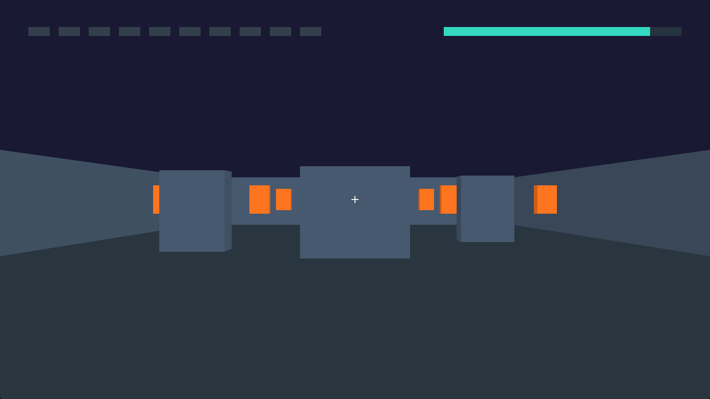

# 共通射撃場

60秒以内に10個の的を撃つ比較用ゲームです。自作エンジン版とUnity版で、20m四方のステージ、移動速度5m/s、120Hz固定更新、射撃間隔などの条件を揃えます。

共通入力を再生し、位置・角度・命中・残りの的・終了状態をステップごとに照合しました。人や実パッドを使った操作感の比較は未完了です。比較の詳細は [comparison/README.md](../../comparison/README.md) を参照してください。
